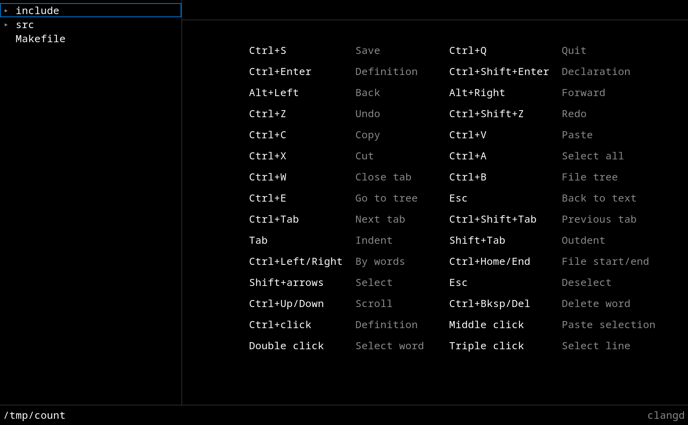

# ce

Ultra simple text editor with a nuclear core.
 * Written in C for C projects.
 * Uses raw [wayland](https://github.com/rustedsword/poor_wayland_swapchain), Vulkan and [io-uring](https://github.com/rustedsword/poor_loop).
 * Syntax highlighting through clangd.
 * Code-base navigation: go to definition, back, forward.
 * No configuration. A single embedded font.

## Build

It needs Linux 6.16, liburing 2.12, Wayland compositor, Vulkan 1.4, a C23 compiler, xkbcommon, FreeType and glslangValidator. 

    $ meson setup build/
    $ ninja -C build/
    $ meson install -C build/ --skip-subprojects

## Run

    $ build/src/ce [DIRECTORY] [FILE]...

The font is Noto Sans Mono, licensed under the SIL Open Font License, see [data/OFL.txt](data/OFL.txt).
